# PharmaCare AI — Real-Time Pharmacoepidemiology System for Improved Patient Care

[](LICENSE)
[](https://fastapi.tiangolo.com/)
[](https://reactjs.org/)
[](https://scikit-learn.org/)
[](https://www.sqlalchemy.org/)

An academic and production-style clinical pharmacovigilance platform designed to monitor chronic disease medication regimens (essential hypertension, type 2 diabetes mellitus, cardiovascular conditions), track reported adverse drug reactions (ADRs), detect statistical safety signals, and aggregate real-time telemetry from IoT-enabled smart medication dispensers.

---

## 📋 Academic Project Roles & Responsibilities

This project realizes the core curriculum requirements across all 5 engineering roles:

| Engineering Role | Responsibilities Realized in PharmaCare AI |
| :--- | :--- |
| **Machine Learning Developer** | • Synthesized and preprocessed chronic care patient cohort (2,500 samples).<br>• Trained explainable **Scikit-Learn Random Forest** classifier predicting severe ADR risk probability.<br>• Implemented WHO-UMC & FDA FAERS **Disproportionality Metrics** (Proportional Reporting Ratio - PRR, Reporting Odds Ratio - ROR, Yates-corrected Chi-Square).<br>• Calibrated feature importance attributions (Age, Polypharmacy, Renal Impairment, Drug Class). |
| **Database Administrator** | • Designed normalized relational schema with SQLAlchemy supporting PostgreSQL and SQLite fallback.<br>• Created tables with primary keys, foreign keys, indexes, and cascades (`users`, `patients`, `medications`, `patient_medications`, `adverse_event_reports`, `safety_reviews`, `iot_devices`, `dispensing_events`, `drug_interactions`, `audit_logs`).<br>• Built automated database seeding script populating realistic synthetic clinical cases and multi-drug interaction rules. |
| **IoT Integration Developer** | • Implemented simulated IoT smart pill dispenser devices (MedSmart-Pro 4G).<br>• Created REST API ingestion endpoints (`POST /api/v1/iot/dispense`) and interactive browser simulation console.<br>• Tracked real-time hardware telemetry: door sensors, internal compartment temperature, battery percentage, missed dose alerts, and 30-day adherence rates. |
| **Frontend Developer** | • Built responsive healthcare SaaS dashboard with **React 18**, **Vite**, and **Tailwind CSS**.<br>• Designed clinical color palette: Navy Blue (`#0f172a`), Clean White, Cyan (`#06b6d4`), and Teal accents.<br>• Integrated interactive database-driven data visualizations using **Recharts** (Area charts, Bar charts, Pie charts).<br>• Implemented 1-click demo role switcher, modal workflows, search, and dynamic status filters. |
| **Backend Developer** | • Developed high-performance REST APIs using **Python FastAPI** and **Pydantic v2**.<br>• Implemented JWT token authentication (access + refresh tokens) and bcrypt password hashing.<br>• Built Role-Based Access Control (RBAC) across 5 healthcare personas.<br>• Integrated **FastAPI WebSockets** (`/ws/feed`) for live event streaming without page reloads.<br>• Built automated PDF and CSV clinical export engines with ReportLab. |

---

## 🏛️ System Architecture

```mermaid
flowchart TD
    subgraph Client ["Frontend (React 18 + Vite + Tailwind CSS)"]
        UI["Healthcare SaaS Dashboard"]
        Store["AuthContext (5 RBAC Roles)"]
        WSClient["WebSocket Live Surveillance Listener"]
    end

    subgraph Server ["Backend (Python FastAPI)"]
        Router["FastAPI REST Router (/api/v1)"]
        WSServer["WebSocket Stream Manager (/ws/feed)"]
        AuthModule["JWT & Bcrypt Security"]
        MLService["Scikit-Learn ML Engine (RandomForest + PRR/ROR)"]
        IoTService["IoT Dispenser Gateway & Telemetry Engine"]
        ReportService["PDF/CSV Clinical Report Generator"]
    end

    subgraph Storage ["Relational Database"]
        DB[("PostgreSQL / SQLite (SQLAlchemy 2.x)")]
    end

    subgraph IoT ["IoT Smart Dispensers"]
        HardwareSim["MedSmart-Pro 4G Virtual Hardware"]
    end

    UI -->|HTTP Requests| Router
    Store -->|Bearer JWT| AuthModule
    HardwareSim -->|Dispensing Telemetry| IoTService
    Router --> MLService
    Router --> IoTService
    Router --> ReportService
    Router --> DB
    IoTService -->|Broadcast Events| WSServer
    Router -->|Broadcast ADRs| WSServer
    WSServer -->|Live Stream| WSClient
```



---

## 👥 Pre-Seeded User Accounts & RBAC Roles

PharmaCare AI features instant **1-Click Demo Profiles** on the login page and navigation bar:

| Role | Email | Password | Clinical Scope & Capabilities |
| :--- | :--- | :--- | :--- |
| **System Admin** | `admin@pharmacare.ai` | `Admin@12345` | User accounts, role assignment, system diagnostics, and tamper-evident audit logs. |
| **Doctor** | `doctor@pharmacare.ai` | `Doctor@12345` | Full EHR patient profiles, active prescriptions, WHO-UMC safety review workflows, ADR reporting. |
| **Pharmacist** | `pharmacist@pharmacare.ai` | `Pharm@12345` | Formulary management, pairwise drug-drug interaction checker, causality review. |
| **Researcher** | `researcher@pharmacare.ai` | `Research@12345` | Anonymized de-identified cohort analytics, statistical PRR/ROR signals, and ML feature weights. |
| **Patient** | `patient@pharmacare.ai` | `Patient@12345` | View personal prescription list, IoT dispenser adherence statistics, submit adverse reaction reports. |

---

## 🔬 Core Clinical Modules

### 1. Authentication & Role-Based Access Control
- Secure registration and login issuing standard OAuth2 Bearer JWT access and refresh tokens.
- Passwords hashed with salted bcrypt.
- Granular permission gates protecting clinician-only and researcher-only endpoints.

### 2. Main Surveillance Dashboard
- Dynamic KPI metrics: Registered Chronic Patients, Active Formularies, Reported ADRs, Pending Safety Reviews, and IoT Adherence Rate.
- 6-Month longitudinal ADR incidence trends (Total vs. Severe vs. Reviewed) via Recharts.
- Therapeutic distribution of chronic medications (ACE inhibitors, ARBs, CCBs, Biguanides, SGLT2 inhibitors, Statins).
- Live real-time activity and audit feed updating dynamically.

### 3. Patient Management (EHR Integration)
- Search by MRN or patient legal name; filter by chronic diagnosis (Hypertension, T2D, Heart Failure).
- Individual patient profile: blood type, allergy list, comorbidities, prescribing history, and adherence gauge.
- Integrated Clinical Timeline combining medication start dates, IoT dispensing telemetry, and ADR incidents.

### 4. Medication Formulary & Drug Interaction Checker
- Comprehensive drug database with therapeutic classes, standard dosages, contraindications, and known adverse effects.
- **Interactive Multi-Drug Interaction Engine**: select any combination of medications to verify pairwise contraindications (e.g., Lisinopril + Spironolactone = Severe Hyperkalemia warning with clinical guidelines).

### 5. Adverse Drug Reaction (ADR) Monitoring & Safety Review
- Standardized incident reporting capturing suspected drug, reaction category (Cardiovascular, Gastrointestinal, Respiratory, Renal), onset date, severity, and clinical narrative.
- **WHO-UMC Causality Assessment Workflow**: clinicians evaluate reports as *Certain*, *Probable*, *Possible*, or *Unlikely*, and record clinical actions (*Dose Adjusted*, *Medication Swapped*, *Discontinued*).
- Status lifecycle: `pending` ➔ `under_review` ➔ `reviewed`.

### 6. AI/ML Safety Analytics (Scikit-Learn)
- **Individualized Risk Scoring**: Supervised Random Forest Classifier (100 estimators, balanced class weights) predicting probability of severe adverse drug events based on patient age, polypharmacy count, renal status, diabetes, and drug class.
- **Explainability**: Gini Impurity feature attribution bar chart ranking individual risk drivers.
- **Population-Level Disproportionality Signals**: Computes Proportional Reporting Ratio (PRR) and Reporting Odds Ratio (ROR) with Yates-corrected Chi-Square ($\chi^2$), identifying statistically significant safety signals (PRR $\ge 2.0$, Count $\ge 3$, $\chi^2 \ge 3.84$).

### 7. Real-Time IoT Dispenser Simulation & Telemetry
- Virtual MedSmart-Pro 4G smart pill dispenser hardware status: battery percentage, cellular connectivity, and firmware version.
- Browser-based simulation console to trigger single dispensing events, missed dose alerts, or jammed compartment alarms.
- Automatic calculation of patient 30-day compliance rates.
- **FastAPI WebSockets** stream events live to all connected sessions without page refresh.

### 8. Reports & Data Export
- 1-Click CSV export for ADR registers and formulary manifests.
- Formatted PDF clinical summary generation via ReportLab.
- Printable layout view formatted for clinical review boards.

### 9. Admin Panel & Immutable Audit Trail
- Manage user permissions and activate/deactivate accounts.
- Audit trail recording timestamps, user identity, action types, entity references, and client IP addresses.
- System diagnostics displaying database table counts and machine learning status.

---

## 🚀 Quickstart Guide

### Prerequisites
- **Python 3.10+** (Python 3.11 / 3.12 / 3.13 supported)
- **Node.js 18+** and **npm 9+**

---

### Method A: Local Development Setup (Quickest)

#### 1. Setup Backend
```bash
# Navigate to backend directory
cd backend

# Create virtual environment
python3 -m venv venv
source venv/bin/activate    # On Windows: venv\Scripts\activate

# Install dependencies
pip install -r requirements.txt

# Seed database with realistic synthetic clinical demonstration data
python app/seed.py

# Launch FastAPI backend server (Runs on port 8000)
uvicorn app.main:app --host 0.0.0.0 --port 8000 --reload
```

#### 2. Setup Frontend
```bash
# In a separate terminal, navigate to frontend directory
cd frontend

# Install npm dependencies
npm install

# Start Vite development server (Runs on port 5173)
npm run dev
```

#### 3. Access Application
- **Frontend Dashboard:** [http://localhost:5173](http://localhost:5173) (or [http://localhost:8000](http://localhost:8000))
- **Interactive Swagger API Docs:** [http://localhost:8000/docs](http://localhost:8000/docs)
- **Alternative Redoc Documentation:** [http://localhost:8000/redoc](http://localhost:8000/redoc)

---

### Method B: Docker Compose Deployment

Run the complete stack (PostgreSQL database, FastAPI backend, and Nginx-served React frontend) in isolated containers:

```bash
# From project root directory
docker-compose up --build
```

- **Frontend App:** [http://localhost:5173](http://localhost:5173)
- **Backend API:** [http://localhost:8000](http://localhost:8000)
- **Database:** PostgreSQL on `localhost:5432`

---

## 🧪 Running Automated Tests

A comprehensive integration test suite verifies API authentication, patient profiles, drug interactions, machine learning inference, and IoT event ingestion:

```bash
cd backend
source venv/bin/activate
PYTHONPATH=. pytest tests/test_api.py -v
```

All 10 automated test suites validate with **100% passing status**.

---

## 🔒 Healthcare Safety & Privacy Notice

> [!IMPORTANT]
> **Academic & Observational Surveillance Prototype:**
> 1. This application is an educational prototype and research demonstration. It is **not** a certified Medical Device or Clinical Decision Support System (CDSS) under FDA, CE-MDR, or relevant regulatory bodies.
> 2. The AI/ML risk scoring model calculates **statistical correlation** from observational synthetic training cohorts; it does **not prove medical causality** and must never be used to override certified clinical judgment or independently discontinue prescription drugs.
> 3. All patient records, medical record numbers (MRNs), and adverse events included in this repository are **synthetic demo data** generated strictly for testing. No Protected Health Information (PHI) is present.
